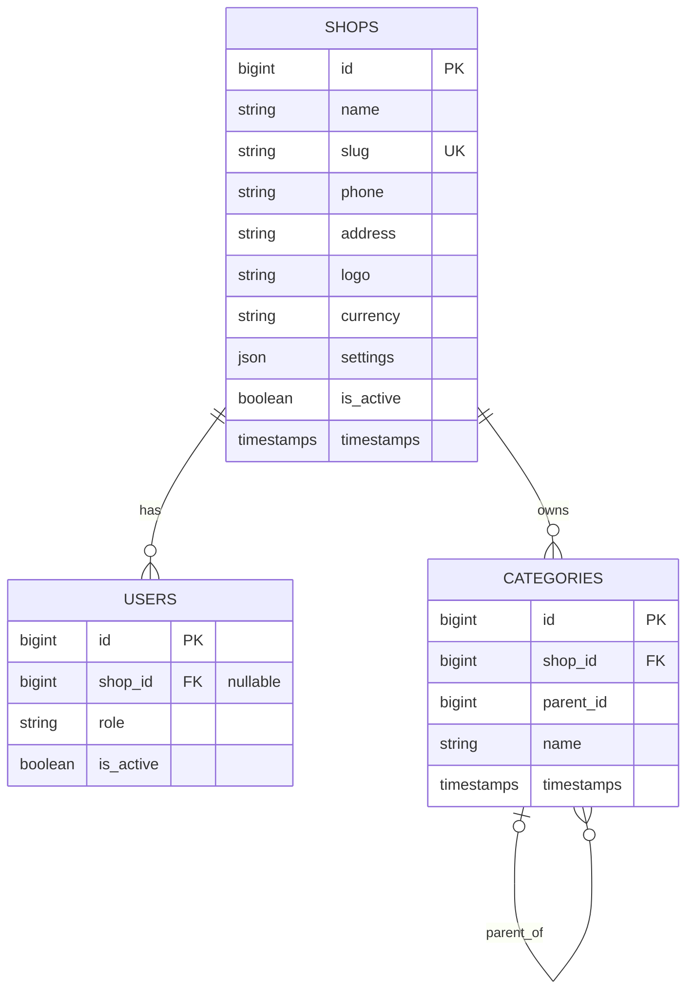
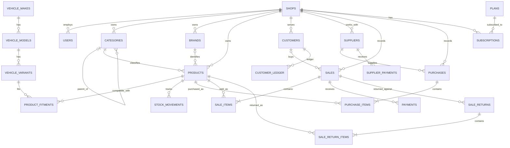

# Database Design

## 1. Project Overview

Inventory and POS SaaS for automotive spare-parts shops in Egypt.

The application uses a single MySQL database shared by multiple shops. Tenant-owned records are isolated using `shop_id`, Eloquent global scopes, model hooks, authorization policies, and database constraints.

This document distinguishes the current implementation from the planned schema. Planned tables and relationships must not be treated as implemented until their migrations and models exist.

## 2. Current Implementation Status

The following tables and models are present in the inspected project files.

| Table | Status | Notes |
|---|---|---|
| `shops` | Implemented | Shop identity, settings, currency, and active status |
| `users` | Implemented | Authentication users with nullable `shop_id`, role, and active status |
| `categories` | Implemented | Tenant-owned hierarchical categories |
| `cache` | Laravel infrastructure | Application cache storage |
| `jobs` | Laravel infrastructure | Database queue storage |
| `passkeys` | Laravel infrastructure | Authentication support |
| User two-factor columns | Implemented | Authentication support |

Current application models include `Shop`, `User`, and `Category`, plus the `BelongsToShop` trait and `ShopScope`.

The complete columns of Laravel infrastructure tables are outside the scope of this document.

## 3. Current Entity Relationship Diagram

The following ERD describes the relationships confirmed by the inspected migrations and models.

Notes:

- `users.shop_id` is nullable in the current migration.
- `categories.shop_id` references `shops.id` and is not nullable.
- `categories.parent_id` is nullable and references a category in the same shop through the composite foreign key `(shop_id, parent_id) -> categories(shop_id, id)`.
- The ERD intentionally omits uninspected columns from Laravel infrastructure tables.

## 4. Current Database Constraints

### 4.1 Shops

The `shops` table currently contains:

- `id`
- `name`
- `slug` with a unique constraint
- `phone`, nullable
- `address`, nullable
- `logo`, nullable
- `currency`, defaulting to `EGP`
- `settings`, nullable JSON
- `is_active`, defaulting to `true`
- timestamps

### 4.2 Users

The tenancy migration adds:

- `shop_id`, nullable, with a foreign key to `shops.id` and `RESTRICT` on delete
- `role`, defaulting to `cashier`
- `is_active`, defaulting to `true`
- a unique constraint on `(shop_id, id)`

The unique `(shop_id, id)` key allows other tenant tables to reference users using composite foreign keys in future migrations.

The current `User` model deliberately does not use `BelongsToShop` or `ShopScope`. Authentication must be able to load a user before a tenant context has been established. Queries that select users for shop administration must use the dedicated shop-user service and explicit shop constraints.

### 4.3 Categories

The `categories` table contains:

- `id`
- `shop_id`, referencing `shops.id` with `RESTRICT` on delete
- `parent_id`, nullable
- `name`
- timestamps
- unique `(shop_id, id)`
- index `(shop_id, parent_id)`
- composite self-reference `(shop_id, parent_id) -> categories(shop_id, id)`, with `RESTRICT` on delete

The composite self-reference prevents a category from referencing a parent category belonging to a different shop at the database level.

## 5. Tenant Isolation Rules

Tenant isolation is a security boundary. Every new tenant-owned model, migration, relationship, and write path must preserve it.

### Layer 1: Database Constraints

Tenant-owned tables should include `shop_id`.

Each tenant-owned table that will be referenced by composite foreign keys should define a unique key on `(shop_id, id)`.

Tenant-owned child tables should reference parent records through composite foreign keys:

`(shop_id, related_id) -> parent_table(shop_id, id)`

Use the project's `tenantForeign()` Blueprint macro where applicable. The `shop_id` column must be defined before calling the macro.

Use `RESTRICT` for tenant foreign keys. Do not introduce `CASCADE` or `SET NULL` for tenant relationships.

Polymorphic references cannot use ordinary foreign keys to enforce the referenced model's tenant ownership. Validate these references in application code and tests.

### Layer 2: Global Scope

Tenant-owned Eloquent models use `ShopScope` through `BelongsToShop`.

`ShopScope` obtains the active tenant ID from `TenantContext` and filters queries by `shop_id`.

The scope fails closed: a query without a valid tenant context must throw `MissingTenantException` instead of exposing records across shops.

### Layer 3: Model Hooks

The `BelongsToShop` trait:

- Assigns `shop_id` from `TenantContext` when creating a record without an explicit tenant ID.
- Rejects creation when an explicit `shop_id` conflicts with a known tenant context.
- Prevents changing `shop_id` during updates.
- Checks tenant ownership during updates and deletes, including operations where global scopes have been removed.

These hooks complement database constraints; they do not replace them.

### Layer 4: Authorization and Validation

Use policies derived from `ShopPolicy` for tenant-sensitive authorization.

Use Form Requests for input validation. `exists` and `unique` rules involving tenant-owned records must be scoped to the current shop.

Access to another shop's records should return 404 where required by the project authorization conventions.

The `User` model is intentionally excluded from the global tenant scope. Use the dedicated `ShopUserService` for tenant-scoped user administration and policies for authorization.

### Layer 5: Tests

Tests should verify:

- Cross-shop reads do not expose records.
- Known IDs belonging to another shop return 404 where required.
- Cross-shop foreign keys are rejected by MySQL.
- A product from another shop cannot be inserted into an invoice.
- Tenant-owned models use `BelongsToShop`.
- Tenant-aware jobs restore the correct tenant context.
- Cache keys include the shop ID.
- Tenant-owned tables are not queried through unapproved raw `DB::table()` access.

The test database must be MySQL, matching the project's test configuration.

## 6. Shared Tables vs. Tenant-Owned Tables

### Shared tables

The planned shared vehicle catalog does not belong to an individual shop and must not have `shop_id`:

- `vehicle_makes`
- `vehicle_models`
- `vehicle_variants`

The planned `plans` table is also shared catalog data.

Shared models must be explicitly distinguished from tenant-owned models in architecture tests. They must not accidentally inherit `BelongsToShop` or `ShopScope`.

### Tenant-owned tables

The target design includes:

- `shops`
- `users` (with the authentication-specific handling described above)
- `subscriptions`
- `categories`
- `brands`
- `products`
- `product_fitments`
- `stock_movements`
- `customers`
- `customer_ledger`
- `suppliers`
- `purchases`
- `purchase_items`
- `supplier_payments`
- `sales`
- `sale_items`
- `payments`
- `sale_returns`
- `sale_return_items`
- `shop_sequences`
- `audit_logs`

This is the planned target list, not a claim that all these tables already exist.

## 7. Planned Target ERD

The following diagram is a high-level roadmap for the intended schema. It shows major relationships, not every foreign key or column. All entities in this section remain planned until implemented by migrations.

The target ERD must be updated as migrations are implemented and reviewed. Exact nullability, delete rules, indexes, and composite foreign keys must be documented alongside each migration.

## 8. Migration Ordering

The following is the intended dependency order for future schema work. Existing migration filenames and their actual execution order remain authoritative for the current database.

1. Shops and authentication tenancy columns.
2. Shared vehicle catalog: makes, models, variants.
3. Tenant catalog: categories, brands.
4. Products and product fitments.
5. Stock movements and inventory opening balances.
6. Customers and customer ledger.
7. Suppliers and purchases, followed by purchase items and supplier payments.
8. Sales and sale items, followed by payments.
9. Sale returns and sale return items.
10. Shop invoice sequences and audit logs.
11. Plans and subscriptions when the subscription phase begins.

Before adding a migration, verify that every referenced table and unique composite key already exists.

## 9. Inventory and Invoice Invariants

### Money

Use `DECIMAL(12,2)` for monetary columns. Do not use floating-point database columns for money.

Invoice calculations belong in a single business-logic service. Persist calculated totals and payment balances consistently within a database transaction.

### Stock ledger

`stock_movements` is the planned inventory ledger. `products.stock_qty` is a cached quantity that must be updated in the same transaction as its stock movement.

Lock the product row with `lockForUpdate()` while performing stock updates.

### Weighted Average Cost

The planned inventory valuation method is Weighted Average Cost (WAC).

For a purchase with a positive resulting quantity:

`new_avg = (old_qty * old_avg + in_qty * in_cost) / (old_qty + in_qty)`

When a negative stock balance is covered by a purchase, treat the previous negative quantity as zero for the average-cost calculation.

Sales record the current average cost as a snapshot on each sale item. Sale returns use the original sale item's unit cost and enter inventory like a purchase. Purchase returns use the current average cost without recalculating the average.

Opening inventory requires a unit cost.

### Sales

Completed invoices must not be edited in place. Correct them through cancellation or returns.

Sale items retain snapshots of product name, unit price, and unit cost.

### Invoice numbering

Use `shop_sequences` with `lockForUpdate()` inside a transaction to generate invoice numbers safely per shop. Enforce unique `(shop_id, invoice_number)` on the relevant invoice table.

## 10. Naming and Implementation Conventions

- Use singular PascalCase model names and plural snake_case table names.
- Use `shop_id` for tenant ownership.
- Use explicit Eloquent relationships for model associations.
- Use `tenantForeign()` for composite tenant foreign keys when applicable.
- Use `RESTRICT` for tenant relationships.
- Keep shared vehicle models separate from tenant-owned models.
- Keep tenant business logic in services and authorization in policies.
- Validate request data using Form Requests.
- Cover tenant boundaries and critical business invariants with Pest tests.
- Run `composer quality` and require exit code `0` before every commit.

## 11. Maintenance

Update this document whenever migrations change the schema or a new tenant-owned/shared model is introduced.

Keep the current implementation section factual. Keep planned features in the roadmap sections until they have been implemented and verified.